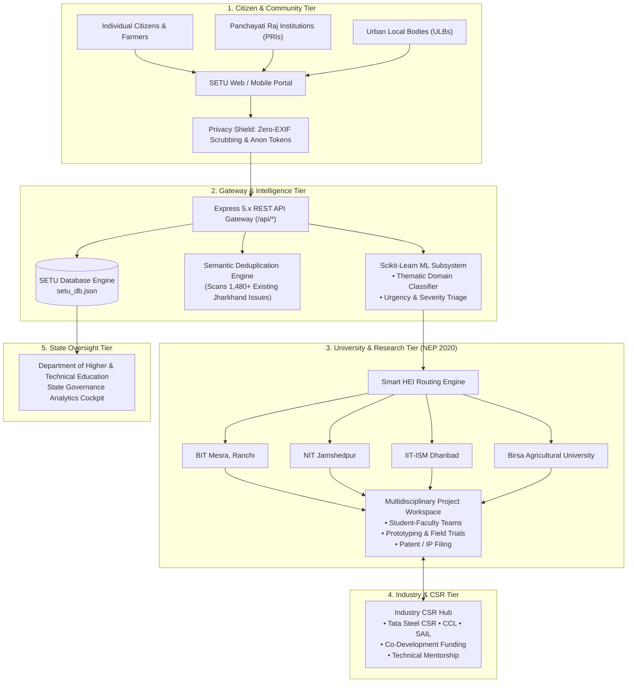

# SETU — Jharkhand Societal Innovation Collaboration Portal

<p align="center">
  
  
  
  
  
</p>

<p align="center">
  <strong>A unified digital platform to crowdsource local societal challenges across all 24 districts of Jharkhand and facilitate collaborative, demand-driven problem solving through Higher Education Institutions (HEIs) and Industry CSR partnerships under NEP 2020.</strong>
</p>

<p align="center">
  <a href="#1-smart-india-hackathon-2026-details">Hackathon Overview</a> •
  <a href="#2-problem-statement--motivation">Motivation</a> •
  <a href="#4-key-features">Key Features</a> •
  <a href="#5-implementation-status-roadmap">Implemented vs Roadmap</a> •
  <a href="#7-system-architecture">Architecture</a> •
  <a href="#9-installation--quickstart">Quickstart</a> •
  <a href="#14-api-documentation">API Docs</a>
</p>

---

## 1. Smart India Hackathon 2026 Details

| Attribute | Details |
| :--- | :--- |
| **Problem Statement ID** | **26043** |
| **Problem Statement Title** | A digital platform to crowdsource societal challenges and facilitate collaborative problem solving through universities and industry partnerships |
| **Organization** | Government of Jharkhand |
| **Department** | Department of Higher & Technical Education |
| **Category** | Software |
| **Theme** | Smart Education |
| **Team Name** | `codemasts` |
| **Policy Framework** | National Education Policy (NEP) 2020 Compliant (Experiential Learning & Community Engagement) |

---

## 2. Problem Statement & Motivation

### Background
Communities across Jharkhand encounter numerous localized challenges related to **drinking water quality (fluoride and arsenic contamination in Santhal Pargana and Kolhan)**, **agricultural vulnerability (frost damage to horticultural crops in Khunti, lack of cold-chain preservation)**, **clean energy access**, **sanitation**, **rural livelihoods (lac, tussar silk, agro-forestry)**, **accessibility**, and **public infrastructure**.

While citizens, Gram Panchayats, and Urban Local Bodies (ULBs) are the first to encounter these challenges, there has been no structured digital gateway through which they can submit problems for systematic evaluation and technological resolution.

Simultaneously, **Higher Education Institutions (HEIs)**—such as **BIT Mesra**, **NIT Jamshedpur**, **IIT-ISM Dhanbad**, **Birsa Agricultural University**, **Ranchi University**, **Sido Kanhu Murmu University (SKMU)**, and **Vinoba Bhave University (VBU)**—possess world-class faculty expertise, research infrastructure, and energetic student researchers eager to work on real-world projects. Furthermore, industrial leaders across Jharkhand (Tata Steel CSR, Central Coalfields Limited [CCL], SAIL Bokaro, and MSMEs) command technical capability and CSR capital.

However, collaboration among **citizens, academia, and industry** has remained fragmented and ad-hoc. **SETU** bridges this gap into an institutionalized, transparent innovation lifecycle.

---

## 3. Objectives of SETU

1. **Grassroots Crowdsourcing**: Enable citizens, Panchayati Raj Institutions (PRIs), Urban Local Bodies (ULBs), and self-help groups across all 24 districts of Jharkhand to submit societal challenges with photo/video proof, audio notes, and GPS coordinates.
2. **AI-Enabled Triage & Deduplication**: Automatically categorize submitted problems across thematic domains (Water, Agriculture, Health, Energy, Infrastructure) and run semantic similarity deduplication scans against existing state issues.
3. **Smart HEI University Allocation**: Match validated challenges with university departments and incubation centres based on faculty specialization and laboratory capabilities.
4. **Multidisciplinary Team Formation**: Allow universities to constitute student-faculty project teams, award NEP 2020 experiential learning academic credits, track milestone deliverables, and file patents.
5. **Industry CSR Co-Development**: Facilitate industry participation for project mentorship, prototype funding, seed grants, and technology commercialization.
6. **State Operational Oversight**: Equip the Department of Higher & Technical Education with a real-time analytics cockpit to track district heatmaps, CSR investments, and social outcomes.

---

## 4. Key Features

- **Intuitive Citizen Intake**: Clean, accessible submission workflow with EXIF privacy stripping and pseudonymous tracking tokens (`CITIZEN-ANON-XXXX-JH`).
- **AI Intelligence Radar**: Real-time natural language problem discovery with semantic guidance and state-wide problem deduplication alerts.
- **Multilingual Support**: Instant client-side localization for **English (`EN`)**, **Hindi (`HI` - हिंदी)**, and **Santhali (`SAT` - ᱥᱟᱱᱛᱟᱲᱤ)**.
- **University Collaboration Hub**: Project milestone tracker, multidisciplinary team constitutions, grant utilization monitors, and patent registration logs.
- **Industry & CSR Marketplace**: Co-development sponsorship hub allowing CSR directors to pledge funds to verified district challenges.
- **State Analytics Cockpit**: Executive dashboard tracking 1,480+ challenges, 48 partner HEIs, ₹14.5 Cr in CSR pledges, and 38 filed patents across Jharkhand.
- **Accessibility & Reduced Motion**: High-contrast Fraunces/Inter typography with an integrated Reduced Motion engine for low-power devices.

---

## 5. Implementation Status & Roadmap

To maintain engineering transparency, the table below outlines what is currently implemented in this repository versus modules under ongoing development.

| Module | Sub-Feature | Status | Notes |
| :--- | :--- | :--- | :--- |
| **Citizen Intake** | Multimedia Web Form & Location Inputs | ✅ Implemented | Supports photo attachments, district/block selectors |
| **Citizen Intake** | Audio Voice Recording & Direct Video Capture | 🟡 In Progress | Basic file upload works; live WebRTC recording planned |
| **Privacy Layer** | EXIF Metadata Scrubbing & Anonymization | ✅ Implemented | Strips camera serials & GPS tags; assigns anon tokens |
| **Localization** | Multi-Language Toggle (EN, HI, SAT) | ✅ Implemented | Instant reactive translation via `src/services/i18n.js` |
| **Accessibility** | Reduced Motion Mode | ✅ Implemented | Disables 3D canvas loops & heavy animations via toggle |
| **Issue Explorer** | Statewide Societal Challenge Repository | ✅ Implemented | District, domain, and keyword search filters |
| **University Hub** | Multidisciplinary Team & Milestone Workspace | ✅ Implemented | Interactive milestone adder, team leads, patent cards |
| **Industry Hub** | CSR Co-Development Sponsorship Grid | ✅ Implemented | CSR pledge metrics, corporate mentor assignment |
| **State Dashboard** | Executive District Heatmaps & Analytics Cockpit | ✅ Implemented | Visual distribution of 24 districts, funding totals |
| **Backend API** | REST Endpoints (`/challenges`, `/auth`, `/health`) | ✅ Implemented | Express 5.x server with JSON database engine |
| **Database** | Persistent File-Backed JSON Store | ✅ Implemented | Complete seed data for 24 districts, HEIs, and CSR partners |
| **Database** | PostgreSQL / MongoDB Production Migration | 🟡 Roadmap | Schema designed; production adapter scheduled for next sprint |
| **Machine Learning** | Scikit-Learn TF-IDF Domain Classifier | ✅ Implemented | Standalone Python pipeline with Subprocess Node.js bridge |
| **Machine Learning** | IndicBERT / Bilingual Semantic Deduplication | 🟡 In Progress | Prototype logic ready; training on Jharkhand dataset underway |
| **Mobile App** | Offline-First Android PWA / React Native APK | 🟡 Roadmap | Responsive web app operational; native wrapper planned |

---

## 6. Technology Stack

### Frontend
- **Framework**: [React 18.3](https://react.dev) with [Vite 5](https://vitejs.dev)
- **Styling**: Modern CSS Glassmorphism, Fraunces editorial serif & Inter sans-serif typography
- **Icons**: [Lucide-React](https://lucide.dev)
- **3D Graphics**: [Three.js](https://threejs.org) (with automatic reduced-motion fallback)
- **Code Splitting**: Custom Rollup chunking for lightweight bundle size

### Backend
- **Runtime**: [Node.js v18+](https://nodejs.org)
- **Web Framework**: [Express 5.x](https://expressjs.com)
- **Authentication**: JWT & Role-Based Access Control (Citizens, HEIs, CSR, State Admins)
- **Persistence**: File-backed JSON ACID Engine (`database/db.js`) with automatic seed initialization

### Machine Learning
- **Language**: Python 3.10+
- **Libraries**: [Scikit-Learn](https://scikit-learn.org), [Joblib](https://joblib.readthedocs.io), [NumPy](https://numpy.org), [PyYAML](https://pyyaml.org)
- **Model**: Sublinear TF-IDF Vectorizer + Multiclass Logistic Regression Pipeline ($< 10\text{ ms}$ inference)
- **Generative AI**: Optional [Google Gemini 1.5 Flash](https://ai.google.dev) for natural language discovery

---

## 7. System Architecture



---

## 8. Project Folder Structure

```text
SETU/
├── backend/                       # Express.js REST API Server
│   ├── config.js                  # Environment & port configuration
│   ├── server.js                  # Main server entry & route mounts
│   ├── middleware/                # Auth & RBAC middlewares
│   ├── routes/                    # API endpoints (/challenges, /chat, /auth, etc.)
│   └── services/                  # Business logic (appointments, ML bridge, routing)
├── database/                      # Database Layer
│   ├── db.js                      # JSON database query engine
│   ├── data/                      # Active persistent database (setu_db.json)
│   ├── schema/                    # JSON schema definitions
│   └── seed/                      # Initial seed data (24 districts, HEIs, CSR)
├── docs/                          # Architectural & technical documentation
│   ├── api.md                     # REST API reference guide
│   ├── architecture.md            # Detailed system design
│   ├── demo.md                    # Step-by-step hackathon demo script
│   └── ml.md                      # Machine learning subsystem specs
├── ml/                            # Machine Learning Python Subsystem
│   ├── config.yaml                # Model hyperparameters & dataset paths
│   ├── requirements.txt           # Python dependencies
│   ├── data/sample/               # Sample training dataset
│   ├── models/                    # Trained .joblib model binaries
│   └── src/                       # Training, inference, and evaluation scripts
├── public/                        # Static assets, video, and animation frame sequences
├── src/                           # React 18 Application Source
│   ├── components/                # Reusable UI widgets (Navbar, Hero, SupportGrid, etc.)
│   ├── pages/                     # Full-page routes (AdminPortal, Counselling, etc.)
│   ├── services/                  # Client stores, API client, i18n, privacyService
│   ├── styles/                    # Global stylesheets and typography
│   ├── App.jsx                    # Root component and client-side router
│   └── main.jsx                   # React DOM entry point
├── .env.example                   # Sanitized environment template
├── .gitignore                     # Git exclusion rules
├── DEVELOPMENT.md                 # Contributor & developer onboarding guide
├── LICENSE                        # MIT License
├── package.json                   # Node.js project manifest & scripts
├── test_api.js                    # Automated end-to-end API test suite
└── vite.config.js                 # Vite build & chunk-splitting configuration
```

---

## 9. Installation & Quickstart

### Prerequisites
- [Node.js](https://nodejs.org) v18.0.0 or higher
- [npm](https://www.npmjs.com) v9.0.0 or higher
- [Python](https://www.python.org) v3.10+ *(required only if retraining the ML model)*

### 1. Clone the Repository
```bash
git clone https://github.com/your-username/setu-jharkhand-portal.git
cd SETU
```

### 2. Install Dependencies
```bash
npm install
```

### 3. Configure Environment Variables
```bash
cp .env.example .env
```
*(The default values in `.env` work out-of-the-box for local testing).*

---

## 10. Frontend Execution Instructions

To start the Vite frontend development server:

```bash
npm run dev
```

The application will be accessible at:
- **Local URL**: `http://localhost:5173` (or `http://localhost:3000`)

---

## 11. Backend Execution Instructions

To start the backend API server:

```bash
npm run server
```

The server will initialize on port 5000:
- **Health Check**: `http://localhost:5000/api/health`
- **Challenges Endpoint**: `http://localhost:5000/api/challenges`

### Running Both Concurrently
You can open two terminal tabs (one for `npm run server` and one for `npm run dev`), or use:
```bash
npm run dev:all
```

---

## 12. Machine Learning Environment & Execution

The ML model comes pre-trained with serialized binaries in `ml/models/`. If you wish to retrain or benchmark the models:

```bash
# 1. Navigate to ML directory & install dependencies
pip install -r ml/requirements.txt

# 2. Train Thematic Domain Classifier
python ml/src/train_intent.py

# 3. Train Urgency & Severity Model
python ml/src/train_urgency.py

# 4. Run Benchmark Evaluation
python ml/src/evaluate.py

# 5. Run Single Prediction Test
python ml/src/predict.py "High fluoride detected in drinking water handpump in Dumka"
```

---

## 13. Stakeholder Demo Credentials

The local database comes pre-seeded with stakeholder accounts for testing:

| Stakeholder Role | Email | Password | Access Rights & Portal View |
| :--- | :--- | :--- | :--- |
| **Citizen / PRI Contributor** | `citizen@setu.jharkhand.gov.in` | `setu123` | Submit challenges, attach evidence, track resolution token |
| **University Faculty / R&D Lead** | `university@setu.jharkhand.gov.in` | `setu123` | HEI R&D Workspace, form student teams, log milestones |
| **Industry CSR Director** | `industry@setu.jharkhand.gov.in` | `setu123` | CSR grant marketplace, pledge co-development funds |
| **State Government Admin** | `admin@setu.jharkhand.gov.in` | `setu123` | Dept. of Higher & Technical Education analytics cockpit |

---

## 14. API Documentation

Comprehensive API documentation is available in [`docs/api.md`](docs/api.md).  
Key endpoint summary:

- `GET  /api/health` — System status & platform metadata
- `GET  /api/challenges` — List crowdsourced societal challenges with district & domain filters
- `POST /api/challenges` — Submit new societal challenge from Citizen / PRI / ULB
- `POST /api/chat` — Conversational problem intake & AI deduplication scan
- `POST /api/ml/classify` — Raw Scikit-Learn TF-IDF domain classification
- `POST /api/auth/login` — Stakeholder login & JWT authentication
- `GET  /api/admin/analytics` — Executive state statistics and district aggregates

---

## 15. Database Information

SETU utilizes a file-backed JSON database engine (`database/db.js`) optimized for rapid prototyping, deterministic demo states, and zero external database dependencies.
- **Data Location**: `database/data/setu_db.json`
- **Seed Source**: `database/seed/initialSeedData.json`
- **Schema Definitions**: Detailed schemas for challenges, universities, industries, and districts reside in `database/schema/schema.json`.

*(For production scale, the query interfaces in `database/db.js` can be mapped directly to PostgreSQL or MongoDB without altering route controllers).*

---

## 16. Screenshots & Interface Preview

| Citizen Problem Intake & AI Radar | University Collaboration Hub |
| :---: | :---: |
| *[Screenshot Placeholder: AI Guided Citizen Submission with Privacy Shield]* | *[Screenshot Placeholder: NEP 2020 Team Workspace & Milestones]* |

| Statewide Challenge Gallery | State Governance Cockpit |
| :---: | :---: |
| *[Screenshot Placeholder: 24 District Filtering & Live Projects]* | *[Screenshot Placeholder: Dept. of Higher Education Analytics]* |

---

## 17. Future Enhancements & Roadmap

1. **Indic Language Voice-to-Text**: Integration of Bhashini / Whisper models for direct speech-to-text in local Santhali, Mundari, Ho, and Kurukh tribal dialects.
2. **Automated Patent Filing Workflow**: Automated IP document generation module aligned with the Indian Patent Office (IPO) fast-track scheme for universities.
3. **Geo-Spatial Satellite Verification**: Automated satellite imagery integration (ISRO Bhuvan / Sentinel-2) to cross-verify agricultural and deforestation reports.
4. **Smart Contract CSR Escrow**: Milestone-gated disbursement of corporate CSR funds upon verified field inspection by district nodal officers.

---

## 18. Contribution Guidelines

Contributions are welcome! Please follow these steps:
1. Review the [`DEVELOPMENT.md`](DEVELOPMENT.md) guide for architecture details.
2. Fork the repository and create your branch: `git checkout -b feature/amazing-feature`.
3. Commit your changes: `git commit -m 'feat: add amazing feature'`.
4. Ensure the build passes: `npm run build`.
5. Push to your branch and open a Pull Request.

---

## 19. License

This project is licensed under the **MIT License** — see the [`LICENSE`](LICENSE) file for details.

---

<p align="center">
  <strong>SETU — Bridging Jharkhand's Societal Challenges with University Innovation</strong><br />
  Smart India Hackathon 2026 • Team <code>codemasts</code>
</p>
